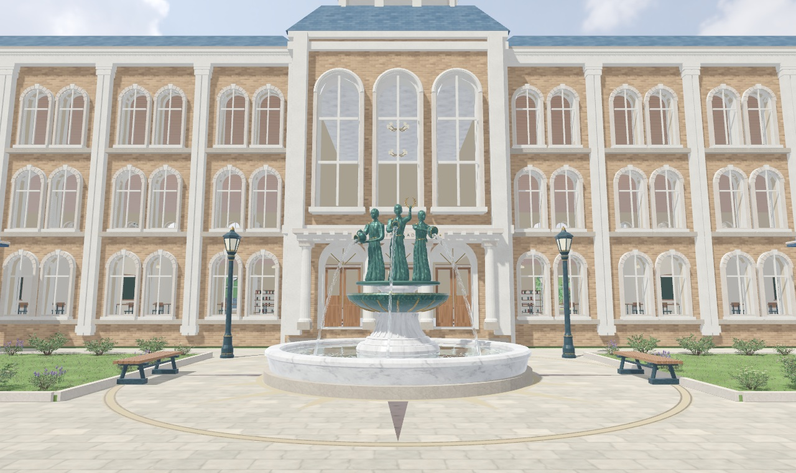

# Tracen Academy campus explorer

A single-player 3D campus exploration prototype built in Godot and Blender. Start at the front gate, follow the avenue past the fountain, explore furnished buildings and residence halls, or head east to the training oval for a free practice lap.



## Run the prototype

Use **Godot 4.7.2** with the Forward+ renderer and install **Git LFS** to fetch the campus model. The current desktop build was checked on macOS. Windows is a target for the packaged demo.

```sh
git lfs install
git clone https://github.com/12chasse-neige/umamu-simulator.git
cd umamu-simulator
git lfs pull
```

Import `project.godot` in the Godot Project Manager, let the first asset import finish, and press **F5**. The playable scene is `game/campus-walk.tscn`. A fresh clone uses a simple runner proxy. A local copy with the optional character export at `art/special-week/special-week.glb` uses that model and its animations.

| Input | Action |
| --- | --- |
| WASD | Move relative to the camera |
| Mouse | Orbit the third-person camera |
| Shift | Sprint |
| C | Hold to crouch |
| Space | Jump |
| E | Open or close a bedroom door when prompted |
| T | Advance to the next time-of-day preset |
| R | Return to the gate |
| Esc / left click | Release or recapture the mouse |

The campus clock advances continuously through daylight, dusk, and night. Follow the signs around the academy wing to the outer rail opening. Timed checkpoints, accounts, saved progress, character selection, and packaged desktop builds are planned milestones. [Development roadmap](docs/develop-plan.md)

## Project files

| Path | Contents |
| --- | --- |
| `game/` | Playable scene, runner and camera, collision, bedroom doors, time-of-day lighting, and regression checks |
| `art/campus/` | Editable Blender campus and kit, Godot-ready GLB, environment preview, and Blender exporter |
| `design/` | Campus map, directory, previews, art references, and texture studies |
| `docs/` | Development plan, planning dimensions, and art-production notes |

The campus handoff covers opening and exporting the Blender scene, running the Godot art preview, and the sources of the campus assets. [Campus art and credits](art/campus/README.md) · [Campus guide](design/tracen-academy/campus-guide.png) · [Texture prompts](docs/campus-texture-prompts.md)

## Run the campus checks

With the project imported, run these commands from the repository root. Use the path to your Godot executable in place of `godot` if it is outside your shell's PATH.

```sh
godot --headless --path . --fixed-fps 60 --script res://game/tests/walk-campus-links.gd
godot --headless --path . --fixed-fps 60 --script res://game/tests/check-residence-doors.gd
godot --headless --path . --fixed-fps 60 --script res://game/tests/check-tree-collision.gd
```
