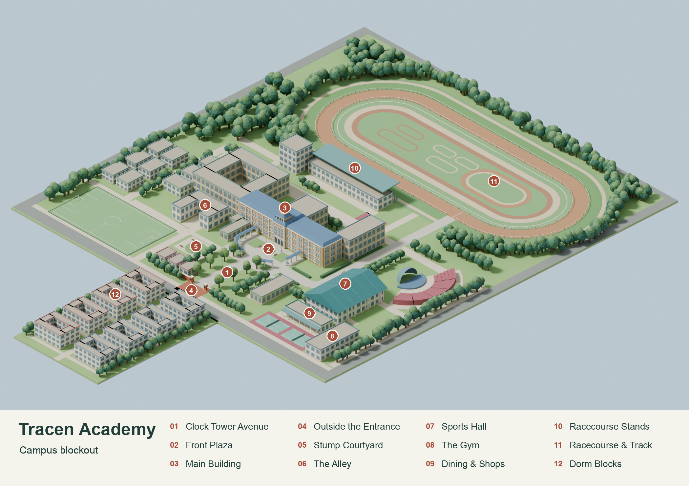

# Milestone 1 · Make Tracen Academy playable

This brief records the original outdoor blockout and proxy-runner milestone. For the current playable build, controls and regressions, use the [project README](../README.md) and [review guide](project-structure.md).

Build one continuous outdoor scene in which a new player can enter through the brick gate, recognize the academy by its clock tower, find the training ground, and run a complete untimed lap. Divide the work into **five regions**. The first three establish the identity of the school, the fourth lets the player discover the track, and the fifth tests running and camera behavior over distance. Each region has its own Blender collection. The current Godot art preview loads the full campus as one scene. [Campus art handoff](../art/campus/README.md)

Start with the [campus guide board](../design/tracen-academy/references/campus-guide-board.webp) for the order of places and the [fountain court](../design/tracen-academy/references/fountain-court.jpg) for their appearance at player height. The [reference index](../design/tracen-academy/references/README.md) lists all eleven downloaded images with their sources, resolutions and modeling uses.

The numbered map shows the expanded campus. The art plan counts the pieces to refine, assigns a surface treatment to each material family and gives a review order for all twelve landmarks. [Campus art production plan](campus-art-production.md)

## Layout and scale

The guide board and annotated aerial agree on three relationships worth keeping. The main approach faces the academic buildings, the landscaped forecourt sits in front of them, and the large oval occupies the grounds beyond. The close aerial makes a fourth relationship legible from above. Covered walks project from the façade and curve around the court. Preserve those relationships when compressing the site. The exact side path, dimensions and compass alignment are project decisions. The sources give illustrated views without a surveyed scale. [Guide board](../design/tracen-academy/references/campus-guide-board.webp) · [Annotated aerial](../design/tracen-academy/references/campus-aerial.webp) · [Court aerial](../design/tracen-academy/references/academy-court-aerial.webp)

Use metres. In Blender the gate centre is **(0, 0, 0)**, +Y leads into campus, +X is the runner’s right at spawn, and Z is up. “East” below means +X on this plan. Keep the playable ground at Z = 0 on the first pass. Coordinates in the table are Blender (X, Y).

| Region | Extent and connection | What must read from the running camera |
|---|---|---|
| 1 · Front gate and avenue | Spawn at (0, −4). Cross an 8 m opening at Y = 0 and follow an 8 m paved avenue to Y = 32. Leave ground behind the spawn for the camera and a turnaround. | The masonry frames the entrance and the tree rows draw the eye to the tower. |
| 2 · Fountain court | A 36 × 22 m forecourt spans X = −18…18 and Y = 32…54. Place a 6 m basin at (0, 47). The track route turns right at (0, 40) and leaves the court at (18, 40). | The fountain marks arrival. An opening in the side arcade and a simple track sign show where to turn. |
| 3 · Academy frontage | Centre a 60 × 14 m exterior shell on X = 0 between Y = 54 and 68. Start with 12 m eaves and a 22 m tower at the centre. The court meets the front steps at Y = 54. | The roof of the central clock tower clears the canopy. The long wings remain visible on either side as the player enters the court. |
| 4 · East training path | From (18, 40) run east to (40, 40), then north to (40, 132). Use a 6 m wide path, a rounded inside corner and a 6 m rail opening at its far end. | As the runner turns alongside the wing, the pale outer rail appears against the dirt. Keep this sightline open all the way to the entrance. |
| 5 · Training oval | Centre at (5, 166). Place bend centres at (−42, 166) and (52, 166). Use two 94 m straights, two 30 m radius semicircles measured on the running centreline, and an 8 m wide tread. | The near straight receives the path. A temporary transverse stripe at X = 40 gives the player a place to start and recognize on return. |

The right-angle route from spawn to the running line is **180 m** (44 m north, 40 m east, 96 m north). The rounded bend shortens it to about 177 m. The primary oval centreline measures **2 × 94 + 2π × 30 ≈ 376.5 m**. Its 8 m tread has an outer footprint of 162 × 68 m. At a constant 9 m/s, allow about 20 seconds to reach the track and 42 seconds per lap. The enlarged Blender scene also includes the nested schooling circuits, stands, dormitories and sports buildings shown on the map. The original playable lap used the primary dirt circuit. The playable scene now uses one continuous tread across the former nested circuits, with guard rails on the two course boundaries. [Current race course](running-meet.md)

## Original Blender blockout brief

| Region | First modeling pass | Collision and detail to revisit |
|---|---|---|
| **1 · Gate and avenue** | Make one brick pier with a pale plinth, cap and dark plaque. Mirror it across the opening and add a short returning wall on each side. Set the brick apron against the lighter avenue. Instance a trunk and two overlapping canopy masses down both sides. Check the gap around the tower from spawn before placing more trees. [Gate](../design/tracen-academy/references/gate.jpg) · [Avenue](../design/tracen-academy/references/avenue.jpg) | One box per pier and wall run. Set tree trunks outside the clear path. Reserve plaque lettering, lamps and individual brickwork for the finish pass. |
| **2 · Fountain court** | Cut the forecourt out of one ground plane. Give the basin a low cylindrical rim, a flat water disc and a single mass for the fountain sculpture. Mark the covered walk with a low curved roof strip and widely spaced supports. Break it where the avenue and east path enter. Place benches and lamps along the edges in pairs. [Fountain court](../design/tracen-academy/references/fountain-court.jpg) · [Court from above](../design/tracen-academy/references/academy-court-aerial.webp) | A cylinder covers the basin and boxes cover the supports. Jog past it on both sides. Keep the main right turn clear of benches. Sculpted figures, water effects and arch molding belong to the finish pass. |
| **3 · Academy frontage** | Block the centre, wings and projecting tower as separate solids. Pitch the tower roof, add one flat clock disc, then make a single 4 m façade bay with a recessed window panel, pale pilasters and cornice. Array bays outward from the centre and use simple end caps. Give the east return and rear a roof and walls so the shell reads from the path and track. [Avenue elevation](../design/tracen-academy/references/avenue.jpg) · [Fan model viewport](../design/tracen-academy/references/fan-model-viewport.jpg) | A few boxes cover the solid building and a ramp covers the front steps. Check the skyline from the track and the proportions from the court before detailing arches, windows or doors. The doors are exterior landmarks in this demo. |
| **4 · East training path** | Draw the centreline through the three stations in the layout table. Give it a constant-width profile and flatten the joints at each end. Use hedge masses to frame the route and place one track-direction marker at the court opening. Lower the hedge on the last stretch to reveal the rail. Use the aerial for the relationship between the buildings and the oval. This specific path is our connection. [Campus aerial](../design/tracen-academy/references/campus-aerial.webp) | Match the walking surface to the court and track apron at both seams. Give the hedge a simple continuous blocker where it bounds play. Check the bend at full speed with the camera on either shoulder. |
| **5 · Training oval** | Build the two straight edges and semicircular ends from the same centreline. Offset the running boundaries by ±4 m, bridge matching edge loops and weld the tangent joins. The current master uses 48 equal segments per semicircle. Derive both rails from those boundaries, instance one post and beam profile, and leave the outer rail open from X = 37…43 on the near straight. Use one infield plane and one dirt material. [Training surface](../design/tracen-academy/references/training-surface.jpg) · [Trackside](../design/tracen-academy/references/trackside.jpg) · [Miho rail reference](../design/tracen-academy/references/miho-training-course.jpg) | Use a flat ground collider beneath the ring and infield. Continuous low segmented barriers follow the rails so the capsule slides past posts. The stripe has zero collision. Leave a clear band around the running line for the later checkpoint volumes. |

## Keep one art style across the campus

Use the daylight in-game campus view as the color reference. The avenue and court previews show the same architectural features at a wider angle. Aim for warm wall panels against pale structural trim, a cool blue roof against the sky, and greenery that frames the architecture. Treat the anime-style aerial as a massing reference. The JRA photo answers construction questions about rails and course surfaces. Its photographic detail would overwhelm the academy at runner height. [Official game view](../design/tracen-academy/references/academy-in-game.jpg) · [Avenue](../design/tracen-academy/references/avenue.jpg) · [Cygames background art interview](https://magazine.cygames.co.jp/ja/archives/735850609)

| Shared material | Proposed sRGB base colors | Treatment for the first pass |
|---|---|---|
| Architecture | Warm ochre panels `#C99B68`, ivory trim `#EEE6D5`, blue slate roof `#66839C` | Model the recess between trim and wall so a single sun reveals the bay rhythm. Give glass one muted blue-gray fill. |
| Gate and paving | Brick `#AF6D54`, paving `#CBC6B7` | Keep masonry matte. Break up long paths with broad joint lines visible at walking speed. |
| Grounds | Canopy `#58865D`, turf `#94B775`, dirt `#B78C68` | Use two or three large foliage masses per crown and broad variations on turf. Use one dirt value across straights and bends. |
| Course furniture | Rail `#ECEADE`, post `#718D82` | Keep a pale continuous top edge against the dirt. Use the same rail module on both curves. |

These starting swatches describe the blockout palette. The current Blender kit contains the shared surface finishes, and the Godot preview sets the daylight and exposure. Use the saved review cameras for comparisons. [Current finishes and preview](../art/campus/README.md)

The four base-color pilots established the repeat scale and palette for shared surfaces. Use the same paving across the avenue, court, and training path and the same turf for the court lawns and track infield. [Texture prompts, pilot images, and repeat checks](campus-texture-prompts.md)

- **Gate view.** Look up the avenue from spawn. At half-size the roof should still read between the trees and the piers should have visible brick and coping planes.
- **Court view.** Face the building from just inside the court. The centre bay, fountain rim and exit to the right should remain legible. Adjust massing or foliage first if the sign has to compete with a wall of detail.
- **Track view.** Look into the first bend from the near straight, then back toward the school. Check that the rail is continuous without visible flicker, the tan tread separates from the infield, and the returning view still has a recognizable roofline.

Compare screenshots side by side with the local references after each campus export. Fix a shared material or the scene light once when several regions drift together. During milestone 1, spend detail only where it changes a silhouette, helps the player turn, or explains a collision. Milestone 4 takes over the final landscaping, signs, rail finish and façade ornament.

## Existing material worth using

- **Campus maps and scenery previews.** Use the guide board for campus organization, the courtyard aerial for the arcade footprint, and the three wide scenery previews for ground-level proportions. The numbered pins on the fan aerial are the guide author’s interpretation. Keep the downloaded images in the design folder for visual study and build the game meshes and textures separately. [Local reference index and source pages](../design/tracen-academy/references/README.md)
- **An existing Blender reconstruction.** Gisulove publishes a Tracen exterior with Blender and FBX versions. The viewport is especially useful for seeing how the curved arcade meets the straight classroom wings. The creator describes the scale as approximate, calls out uncertainty at the rear, and supplies the model without UVs or materials. The listing also restricts use and redistribution. Use the published preview to compare the massing of our own shell. [Local preview](../design/tracen-academy/references/fan-model-viewport.jpg) · [Creator’s listing and terms](https://booth.pm/ja/items/4288843)

## Assembly and handoff to Godot

1. **Prove scale with one export.** Set Blender to metric, unit scale 1. Put a 1 m cube, a 1.7 m runner proxy and an arrow pointing into campus in a test collection. Export a GLB with the standard glTF axis conversion. In Godot check the cube against a 1 m box and confirm that Blender +Y points toward Godot −Z. A Blender ground point (X, Y, 0) should land at Godot (X, 0, −Y). Fix a scale or facing mismatch here before cutting the regions.
2. **Build the whole footprint in one master file.** Use `art/campus/campus.blend` with five playable-route collections named `gate_avenue`, `fountain_court`, `academy_frontage`, `training_path` and `training_oval`. Link the materials, façade bay, tree and rail modules from `art/campus/kit.blend`. Align the collections to the same gate origin. Each walkable surface has one owner at a seam. Keep the metric plan, source images, scale proxy and review aids in a non-export collection.
3. **Use the campus art preview to check the handoff.** Refresh `campus.glb` and run `campus-preview.tscn` from `res://art/campus/`. Add gameplay, simplified collision and spawn markers in the playable scene. Check the track entrance and the joint with the training path after reimporting. [Godot glTF import guide](https://docs.godotengine.org/en/stable/tutorials/assets_pipeline/importing_3d_scenes/available_formats.html)
4. **Tune movement against the geometry.** Use a `CharacterBody3D` capsule about 1.7 m tall and 0.35 m in radius. Start with 3 m/s walking and 9 m/s on Shift. Map WASD to normalized camera-relative ground directions. Mouse motion orbits a shoulder-height pivot with clamped pitch. Start the spring arm at 3.5 m with a 65° vertical field of view. Make the camera a direct child of the spring arm, exclude the runner from its collision query, and include walls, rails and solid hedges. Test the gate and tight turns first. [Godot spring-arm guide](https://docs.godotengine.org/en/stable/tutorials/3d/spring_arm.html)
5. **Lock the route and hand off the oval.** After the unassisted route test passes, freeze the gate origin, entry gap and running centreline for milestone 2. Use the saved start marker at Blender (40, 136, 0), facing east along the near straight. Record the chosen lap direction and centreline length alongside the track scene. Milestone 2 owns the countdown, ordered checkpoints and lap result.

## Milestone review

| Review | Test on the Godot build | Pass condition |
|---|---|---|
| Gate to track | Start someone at the gate with only the controls and the instruction “find the training track.” Watch where they first hesitate. | They identify the academy, take the court exit and reach the rail opening without a map overlay or spoken directions. If they head for the front doors, adjust the side opening and marker before adding props. |
| Running surface | Walk across every region seam, then run two circuits, one near each rail. Enter and leave through the gap. | The capsule stays grounded, clears each seam and slides around both bends without snagging, dropping, or catching on posts. |
| Camera clearance | Orbit through a full turn beside a pier, the fountain, the façade, the path hedge and the outer rail. Repeat while running around a bend. | The runner stays visible, the camera retracts before crossing a solid surface and recovers its normal distance in open space. |
| Recognizability and pacing | Save the three review views. Record gate-to-track time and one centreline lap at the selected run speed with a stopwatch. | The gate, tower, fountain and oval read at play resolution. A lap is close to the predicted 42 seconds at 9 m/s. Explain any material difference in terms of path, acceleration or steering before resizing the campus. |
| Reimport | Re-export the changed campus and reopen the scene. | The shared origin, adjacent ground heights, player spawn and start marker still line up. The same route and lap remain playable. |

The milestone is ready when the placeholder runner can make the trip and complete the lap in this scene. Carry the approved layout, editable collections, campus GLB and saved review cameras into the timed-lap milestone. [Overall development plan](develop-plan.md)
